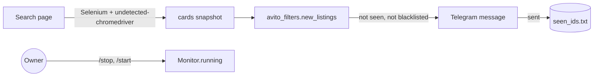

# Apartment Listing Monitor


Monitors a classifieds search page and sends new rental listings to Telegram, skipping unwanted metro stations.

Built for my own flat hunt in Saint Petersburg: instead of refreshing the search page by hand, new listings arrive in Telegram a few minutes after they are published.

## Example message

```
New listing
м. Парнас, 7 мин.
35 000 ₽ в месяц

https://www.avito.ru/sankt-peterburg/kvartiry/...
```

## How it works



| File | Responsibility |
|---|---|
| `avito_filters.py` | Pure logic: parse a card, blacklist filter, de-duplication |
| `monitor.py` | Browser session, check loop with random 2.5-4 min pauses, owner commands |
| `tg_client.py` | Minimal Telegram Bot API client (send, long-poll owner commands) |
| `store.py` | Seen listings on disk, so a restart sends no duplicates |

## Design decisions
- **The browser is an adapter.** Logic works with a small `Card` protocol, so it is tested without Chrome; Selenium is imported only at run time.
- **A listing is marked as seen only after Telegram accepted it,** so a network error means a retry, not a lost listing.
- **Gentle pace.** One page load every 2.5-4 minutes with human-like pauses; captchas are not bypassed.
- **Owner-only control** via `/stop` and `/start`; commands from other chats are ignored.
- **Logs never contain the bot token** (the Telegram URL is not logged).

## Features
- Polls the search URL every 2.5-4 minutes with randomised delays
- Blacklist filter by metro station
- Remembers seen listings (no duplicates after restart)
- Remote control from Telegram: `/stop` pauses, `/start` resumes (owner chat only)

## Stack
Python 3.11+, Selenium + undetected-chromedriver, Telegram Bot API (requests)

## Setup
```bash
python -m venv .venv && source .venv/bin/activate   # Windows: .venv\Scripts\activate
pip install -r requirements.txt
cp .env.example .env        # fill in your values
python monitor.py
```
Requires Google Chrome installed.

## Configuration
| Variable | Description |
|---|---|
| `TELEGRAM_BOT_TOKEN` | Bot token from BotFather |
| `TELEGRAM_CHAT_ID` | Numeric ID of your chat |
| `SEARCH_URL` | Search results page to monitor |
| `BLACKLIST_METRO` | Optional, comma-separated stations to skip |

## Disclaimer
For personal use. Respect the terms of service of any site you query.

## Tests
```bash
pip install -r requirements-dev.txt
ruff check . && pytest --cov=.
```
Card parsing, filtering, de-duplication, the seen-store, owner command handling and the retry-on-failed-send rule are covered without a browser or network.

## Limitations
- CSS markers of the site can change; the parser then skips cards instead of crashing, but needs an update.
- One search URL per process.

License: MIT
